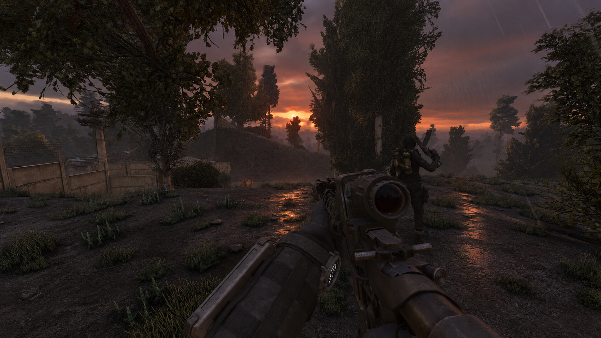

  

# GAMMA Mod Releases

Player light controls and community projects for **S.T.A.L.K.E.R. Anomaly / GAMMA**.

Light 2.1.1 supports official UTLF 1.0.2 and preserves the earlier firing correction. The owner accepted the matched RC pair; documented clone/beam/battery limits remain. Both stable Releases provide installable archives and corresponding source.

## One Key Light 2.1.1

Control your installed lights with one key: **Tap, Double Tap, Hold**, or the **Quick Light Menu**. Works independently; add Unified for advanced modes and NVG linking.

- Configurable gestures, menu themes and readable device states.
- Normal/IR headlamp support, weapon lights and optional laser integration.
- Explicit vanilla Torch binding clear/restore.

**Released:** [Version 2.1.1](https://github.com/ProfessorMaterialistic/GAMMA-Mod-Releases/releases/tag/one-key-light-v2.1.1).

[Download](mods/One-Key-Light/README.md#download) · [Install](mods/One-Key-Light/INSTALL.md) · [Requirements](mods/One-Key-Light/COMPATIBILITY.md) · [Features](mods/One-Key-Light/FEATURES.md) · [Changelog](mods/One-Key-Light/CHANGELOG.md)

## Unified Player Light Controls 2.1.1

Keep light modes and tuning consistent across native controls and supported device dialogs. Link visible/IR channels to NVG state, with AUTO for supported weapon lights and lasers.

- Saved device modes and independent tuning.
- Separate or NVG Linked weapon/headlamp routes.
- Works alone or with One Key's gestures and menu.

**Released:** [Version 2.1.1](https://github.com/ProfessorMaterialistic/GAMMA-Mod-Releases/releases/tag/unified-player-light-controls-v2.1.1).

[Download](mods/Unified-Player-Light-Controls/README.md#download) · [Install](mods/Unified-Player-Light-Controls/INSTALL.md) · [Requirements](mods/Unified-Player-Light-Controls/COMPATIBILITY.md) · [Features](mods/Unified-Player-Light-Controls/FEATURES.md) · [Changelog](mods/Unified-Player-Light-Controls/CHANGELOG.md)

## Auto NVG Stow for Wearable Devices 0.1.2

Automatically lift active ordinary NVGs before viewing Promin or Vektor, then
restore them when you lower the wearable. Manual NVG input takes priority.
Fatal Error is optional for the inspected Beef/Better Beef + FDDA stack.

**Released:** [Version 0.1.2](https://github.com/ProfessorMaterialistic/GAMMA-Mod-Releases/releases/tag/auto-nvg-stow-v0.1.2).
The owner confirmed correct operation on the known deployed Better Beef +
AutoNVG + Fatal Error setup; other combinations and individual variants are
source-validated and not separately gameplay-confirmed.

[Download](https://github.com/ProfessorMaterialistic/GAMMA-Mod-Releases/releases/download/auto-nvg-stow-v0.1.2/Auto-NVG-Stow-for-Wearable-Devices-v0.1.2.7z)
· [Install](mods/Auto-NVG-Stow/INSTALL.md) · [Requirements and limits](mods/Auto-NVG-Stow/COMPATIBILITY.md)
· [Changelog](mods/Auto-NVG-Stow/CHANGELOG.md)

## HUD and inventory projects

- [HUD Readability 0.2.1](mods/HUD-Readability/README.md): customizable stamina/radiation
  feedback with the owner-confirmed AURA stamina texture repair.
- [SOTA Wearable Slots 0.1.0](mods/SOTA-Wearable-Slots/README.md): the accepted Bracer,
  Promin and Vektor row for SOTA/FIUT, with equipped devices omitted from the bag.

Project documentation is available; these two versions do not yet have public download archives.

## Wearable screen theme and HD cursor

- [Wearable Devices Monochrome UI 1.0.0](mods/Wearable-Devices-Monochrome-UI/README.md):
  coordinated white-on-black Promin/Vektor screens, preserving AURA overlays.
- [KokoNya HD Cursor 0.1.0](mods/KokoNya-HD-Cursor/README.md): higher-resolution
  cursor artwork with the original size and click origin on the inspected DX11 path.

Both have local validation; separate in-game acceptance remains unrecorded.
These pages provide documentation, not downloadable archives.

## In development

| Project | Status |
| --- | --- |
| [Auto NVG](mods/Beefs-NVG-Automatic-Gain-Control/README.md) | v0.4 partially tested; v0.4.1 exposure correction planned; no download |
| [Grenades Expanded](mods/Grenades-Expanded/README.md) | In development |
| GEKF | Future framework; not implemented on the maintained engine base |

## Help

[Installation guide](docs/INSTALLATION-GUIDE.md) · [Troubleshooting](docs/TROUBLESHOOTING.md) · [Report a bug](https://github.com/ProfessorMaterialistic/GAMMA-Mod-Releases/issues/new/choose) · [Mod index](docs/MOD-INDEX.md) · [Visual roadmap](ROADMAP.md)

Showcase recording **complete** · Discord posting **pending**. [Showcase checklist](docs/LIGHT-SHOWCASE-CHECKLIST.md).

[Credits](CREDITS.md) · [Release policy](RELEASE-POLICY.md) · [Redistribution review](docs/LIGHT-REDISTRIBUTION-REVIEW.md)

Independent community project; no affiliation or endorsement by GSC Game World or the GAMMA team.
